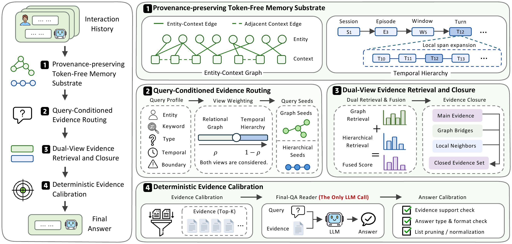

# 🧠 Zero-Mem

> **Zero-Mem: Zero-Token Memory Operations for LLM Agents**

Zero-Mem is a structured memory framework for LLM agents. It retains original interaction traces and organizes them through an entity–context graph and a temporal hierarchy. Query-conditioned retrieval and deterministic calibration select evidence for the final question-answering reader.

The term **zero-token memory operations** means that memory construction, organization, routing, retrieval, evidence closure, and calibration use no LLM calls or LLM input/output tokens. Encoder and NER computation, storage, and final-QA inference still have costs.

## 📢 News

- **[2026-10-26]** Our **[Code](https://https://github.com/Zero-Mem/Zero-mem)** is released!
- **[2026-07-31]** We release the paper **[Zero-Mem](https://arxiv.org/abs/2607.29377)**.
---

## 🔎 Overview

- **Original traces as the source of record.** Retrieved evidence retains its source and available session, speaker, and temporal metadata.
- **Complementary retrieval views.** The graph exposes relational connections; the hierarchy preserves local context and temporal order.
- **Query-conditioned evidence selection.** Routing adjusts view priorities, while fusion and bounded evidence closure gather supporting context.
- **Generation at final QA.** A reader LLM answers from the selected evidence; evidence and answer calibration are deterministic.

## 🛠️ Method

1. **Build the memory substrate.** Extract entities and encode source units without generating summaries or semantic triples. Construct the entity–context graph and temporal hierarchy over the original text.
2. **Profile the query.** Identify subject, lexical, answer-type, temporal, and source-boundary cues to coordinate retrieval.
3. **Retrieve and complete evidence.** Combine graph and hierarchical candidates, then add bounded relational or local support.
4. **Calibrate and answer.** Filter evidence before final QA and apply deterministic evidence-support, type, and format checks to the reader output.

[](assets/main_figure.png)

## 📄 Repository Structure

```text
.
├── README.md
├── requirements.txt
├── run.py
├── assets/
│   └── main_figure.png
└── src/
    ├── ZeroMem.py
    ├── config.py
    ├── indexing.py
    ├── embedding_store.py
    ├── ner.py
    ├── query.py
    ├── retrieval.py
    ├── evidence.py
    ├── reader.py
    ├── answer_calibration.py
    ├── answer_extraction.py
    ├── data_io.py
    └── utils.py
```

`run.py` is the generation entry point. `ZeroMem` combines the retrieval and Reader components; `ZeroMemConfig` holds runtime settings. `ZeroMemReaderClient` manages final-QA requests and call diagnostics.

## 📦 Installation

Run the commands below from the repository root in an activated Python environment.

```bash
python -m pip install -r requirements.txt
python -m spacy download en_core_web_trf
```

`requirements.txt` lists direct dependencies; it is not a version-locked environment. Model weights and datasets are obtained separately. The examples explicitly select **BGE-M3**, the dense encoder described in the manuscript, and `gpt-4o-mini` as the final reader. A local Sentence Transformers model directory can also be supplied through `EMBEDDING_MODEL`.

For GPU execution, install a PyTorch build compatible with your CUDA environment. spaCy GPU execution additionally requires a compatible CuPy installation; see the [spaCy installation guide](https://spacy.io/usage). The examples run spaCy on the CPU and select the embedding device automatically. After configuring GPU support, set `SPACY_NER_DEVICE=cuda` and `EMBEDDING_DEVICE=cuda` if desired.

### Configure the reader

The client uses an [OpenAI-compatible Chat Completions endpoint](https://developers.openai.com/api/reference/resources/chat/subresources/completions/methods/create). Set the endpoint and enter the key privately in your shell:

```bash
export OPENAI_BASE_URL="${OPENAI_BASE_URL:-https://api.openai.com/v1}"
if [[ -z "${OPENAI_API_KEY:-}" ]]; then
  read -rsp 'API key: ' OPENAI_API_KEY
  printf '\n'
fi
export OPENAI_API_KEY
export LLM_MODEL="${LLM_MODEL:-gpt-4o-mini}"
export EMBEDDING_MODEL="${EMBEDDING_MODEL:-BAAI/bge-m3}"
unset LLM_SEED
```

Use a model identifier actually served by the configured endpoint. Keep credentials and private runtime artifacts outside the public source repository.

## 📂 Data Preparation

Datasets are supplied separately. The loader supports two layouts.

**LoCoMo conversations:** place the original conversation/QA JSON array at the repository root:

```text
locomo10.json
```

**Prepared question–corpus pairs:** place two JSON arrays under the dataset directory:

```text
dataset/
├── hotpotqa56K/
│   ├── questions.json
│   └── chunks.json
└── hotpotqa224K/
    ├── questions.json
    └── chunks.json
```

Question objects use `question` and, for evaluation, `answer` or `gold_answer`. Chunks may be strings or objects containing `text`. Preserve source-boundary identifiers such as `sample_id` when the questions and corpus contain separate contexts.

The paired layout also works for `locomo10`. If both paired files exist, they take precedence over the root-level conversation file. For `--dataset_name locomo10`, the conversation fallback is `locomo10.json`, not `dataset/locomo10/locomo10.json`.

Prepare the corpus and boundaries for the intended benchmark protocol. A directory name such as `hotpotqa224K` does not construct a 224K-token context. Use matching context construction, question splits, models, and scoring when comparing with the manuscript.

## 🚀 Quick Start

The examples below use **Bash**. Configure the reader and set the shared options in the same shell, then choose a dataset to run. Rebuild `COMMON_ARGS` after changing model or device settings. Each example generates answers for the full selected question set.

```bash
COMMON_ARGS=(
  --eval_mode fusion --question_limit 0
  --use_vectorized_retrieval --skip_internal_evaluation
  --embedding_model "${EMBEDDING_MODEL:-BAAI/bge-m3}"
  --embedding_device "${EMBEDDING_DEVICE:-auto}" --embedding_batch_size 16
  --spacy_model en_core_web_trf
  --spacy_ner_device "${SPACY_NER_DEVICE:-cpu}" --spacy_ner_batch_size 32
  --llm_model "${LLM_MODEL:-gpt-4o-mini}" --max_workers 4 --qa_workers 4
  --retrieval_batch_size 32 --retrieval_top_k 5
  --reader_max_hierarchy_turns 8 --reader_max_hierarchy_trigrams 3
  --reader_prompt_token_budget 8000 --fusion_support_passage_budget 2
  --max_iterations 3 --iteration_threshold 0.35 --passage_ratio 2.0
  --damping 0.6 --top_k_sentence 3
  --fusion_route_primary_weight 0.6 --fusion_route_secondary_weight 0.4
)
```

The damping and routing weights are set explicitly. The routing weights apply to the query-selected primary and secondary views. Top-5 is the primary-candidate budget; closure can add bounded supporting units.

Each fresh-run block checks the shared options, credentials, project files, and dataset before clearing its selected cache. Link checks stop cleanup if the cache or its parent is a symbolic link. A new output path is generated and printed for each fresh run. The commands run in a subshell so their `set -e` setting stays local.

### LoCoMo

```bash
(
  set -e
  if [[ ! -f run.py || ! -f src/ZeroMem.py ]]; then
    printf 'Run this command from the repository root.\n' >&2
    exit 1
  fi
  if [[ -z "${COMMON_ARGS[0]:-}" ]]; then
    printf 'Run the shared-options block first in this Bash shell.\n' >&2
    exit 1
  fi
  : "${OPENAI_API_KEY:?Set OPENAI_API_KEY before running}"
  : "${OPENAI_BASE_URL:?Set OPENAI_BASE_URL before running}"
  if [[ ! -f locomo10.json ]] &&
     [[ ! -f dataset/locomo10/questions.json || ! -f dataset/locomo10/chunks.json ]]; then
    printf 'Missing LoCoMo data; see Data Preparation.\n' >&2
    exit 1
  fi
  test ! -L import
  test ! -L import/locomo10
  OUT="results/locomo10/$(date +%Y%m%d_%H%M%S)/run_output"
  [[ ! -e "$OUT" ]] || { printf 'Output already exists; start a new run.\n' >&2; exit 1; }
  printf 'Output: %s\n' "$OUT"
  rm -rf -- import/locomo10
  python -u run.py "${COMMON_ARGS[@]}" \
    --dataset_name locomo10 --skip_categories 5 \
    --output_dir "$OUT"
)
```

`--skip_categories 5` selects categories 1–4 for the comparison reported in the manuscript.

### HotpotQA 56K

```bash
(
  set -e
  if [[ ! -f run.py || ! -f src/ZeroMem.py ]]; then
    printf 'Run this command from the repository root.\n' >&2
    exit 1
  fi
  if [[ -z "${COMMON_ARGS[0]:-}" ]]; then
    printf 'Run the shared-options block first in this Bash shell.\n' >&2
    exit 1
  fi
  : "${OPENAI_API_KEY:?Set OPENAI_API_KEY before running}"
  : "${OPENAI_BASE_URL:?Set OPENAI_BASE_URL before running}"
  if [[ ! -f dataset/hotpotqa56K/questions.json || ! -f dataset/hotpotqa56K/chunks.json ]]; then
    printf 'Missing hotpotqa56K questions.json or chunks.json.\n' >&2
    exit 1
  fi
  test ! -L import
  test ! -L import/hotpotqa56K
  OUT="results/hotpotqa56K/$(date +%Y%m%d_%H%M%S)/run_output"
  [[ ! -e "$OUT" ]] || { printf 'Output already exists; start a new run.\n' >&2; exit 1; }
  printf 'Output: %s\n' "$OUT"
  rm -rf -- import/hotpotqa56K
  python -u run.py "${COMMON_ARGS[@]}" \
    --dataset_name hotpotqa56K \
    --output_dir "$OUT"
)
```

### HotpotQA 224K

```bash
(
  set -e
  if [[ ! -f run.py || ! -f src/ZeroMem.py ]]; then
    printf 'Run this command from the repository root.\n' >&2
    exit 1
  fi
  if [[ -z "${COMMON_ARGS[0]:-}" ]]; then
    printf 'Run the shared-options block first in this Bash shell.\n' >&2
    exit 1
  fi
  : "${OPENAI_API_KEY:?Set OPENAI_API_KEY before running}"
  : "${OPENAI_BASE_URL:?Set OPENAI_BASE_URL before running}"
  if [[ ! -f dataset/hotpotqa224K/questions.json || ! -f dataset/hotpotqa224K/chunks.json ]]; then
    printf 'Missing hotpotqa224K questions.json or chunks.json.\n' >&2
    exit 1
  fi
  test ! -L import
  test ! -L import/hotpotqa224K
  OUT="results/hotpotqa224K/$(date +%Y%m%d_%H%M%S)/run_output"
  [[ ! -e "$OUT" ]] || { printf 'Output already exists; start a new run.\n' >&2; exit 1; }
  printf 'Output: %s\n' "$OUT"
  rm -rf -- import/hotpotqa224K
  python -u run.py "${COMMON_ARGS[@]}" \
    --dataset_name hotpotqa224K \
    --output_dir "$OUT"
)
```

Use `--eval_mode graph` or `--eval_mode hierarchy` for individual-view runs. `--eval_mode all` runs all three modes and generates separate answers for each. Available options can be inspected after installation with `python run.py --help`.

## 📊 Results Reported in the Manuscript

Scores are percentages. LoCoMo columns reproduce the Average values in the manuscript's main results table; HotpotQA columns report F1 at the specified context settings.

| Final-QA reader | LoCoMo F1 | LoCoMo BLEU-1 | HotpotQA 56K F1 | HotpotQA 224K F1 | HotpotQA 448K F1 |
| --- | ---: | ---: | ---: | ---: | ---: |
| GPT-4o-mini | 59.15 | 52.96 | 72.07 | 66.43 | 65.04 |
| Qwen2.5-14B-Instruct | 57.57 | 51.41 | 68.58 | 65.47 | 61.02 |

These are manuscript-reported results, not new measurements of this release. Reproduction requires matching the paper's data construction, reader backend, encoder, configuration, and evaluation protocol. Dataset files and the Qwen reader serving environment are not bundled.

The manuscript also reports **57.6% lower memory-operation time** than the fastest compared baseline, LightMem, under its controlled setup. This comparison covers memory operations outside final QA; it is not an end-to-end reader latency measurement.

## 📁 Outputs and Evaluation

For `--eval_mode fusion`, each output directory contains:

| File | Contents |
| --- | --- |
| `predictions_fusion.json` | Compact predictions for downstream evaluation |
| `predictions_fusion_raw.json` | Detailed predictions and evidence records |
| `predictions_fusion_raw.jsonl` | Incremental records for resuming interrupted runs |
| `run_config.json` | Runtime configuration and source provenance |
| `performance.json` | Stage timings, reported reader usage, and call statistics |
| `failed_fusion.jsonl` | Failed-question diagnostics, when failures occur |
| `log.txt` | Application log |

For `graph` and `hierarchy`, prediction and failure filenames use the corresponding mode name; `all` produces all three sets in the output directory. The entry point generates answers without computing benchmark scores. Score predictions with the corresponding benchmark protocol.

To resume an interrupted run, preserve the original output directory, including `predictions_fusion_raw.jsonl` and `run_config.json`. Set `OUT` in your current Bash shell to the exact output path printed by that run. Rerun **only the Python generation command** from the corresponding example and append `--resume`. Reuse the same `COMMON_ARGS`, dataset selection, source version, data, endpoint, model, and generation settings. Skip the entire fresh-run block so the cache is preserved and no new output path is generated.

In this release, `--reader_prompt_token_budget` uses an approximate **whitespace-word** budget during evidence construction. Actual final-QA token usage is reported separately when returned by the provider.

## 🔗 Citation

If you find this project useful, please cite our paper:

```bibtex
@misc{xiao2026zeromemzerotokenmemoryoperations,
      title={Zero-Mem: Zero-Token Memory Operations for LLM Agents}, 
      author={Yilin Xiao and Zhehan Zhu and Yujing Zhang and Jin Chen and Zijin Hong and Luyao Zhuang and Qinggang Zhang and Shengyuan Chen and Xiaocao Ouyang and Lingfei Ren and Xiao Huang},
      year={2026},
      eprint={2607.29377},
      archivePrefix={arXiv},
      primaryClass={cs.CL},
      url={https://arxiv.org/abs/2607.29377}, 
}

``` 
